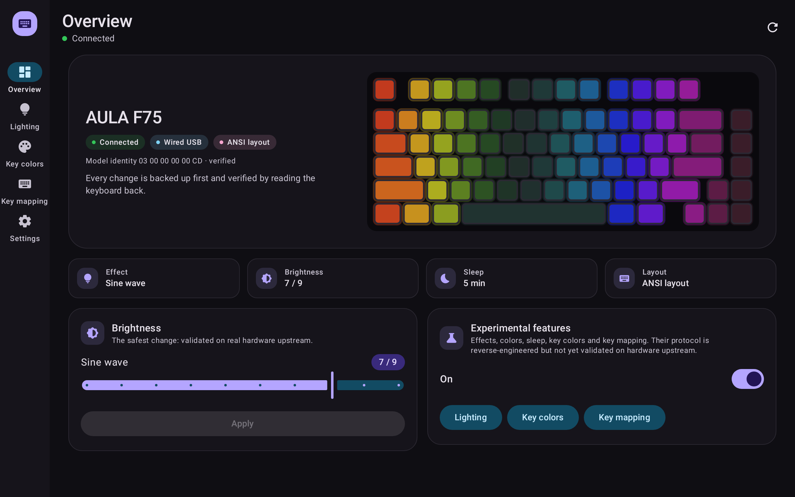
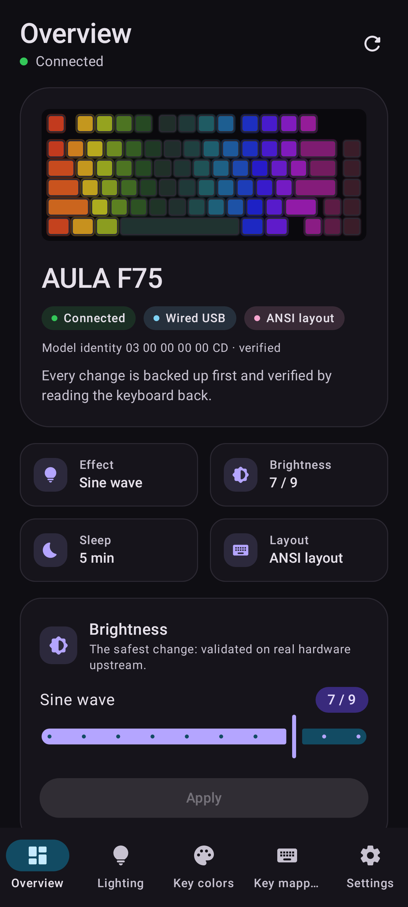
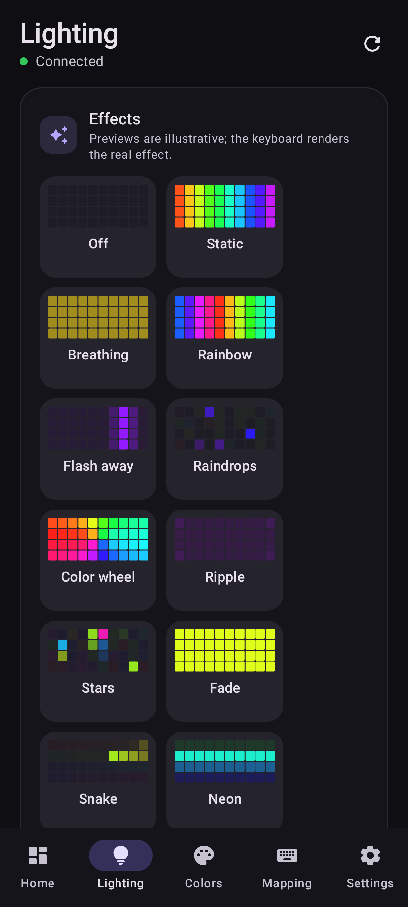
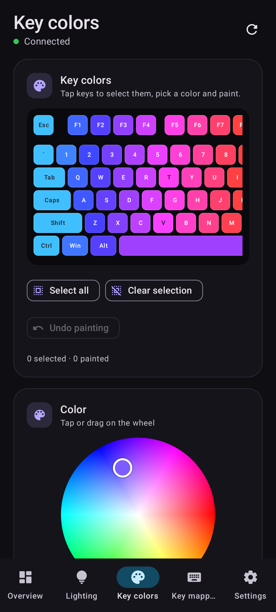
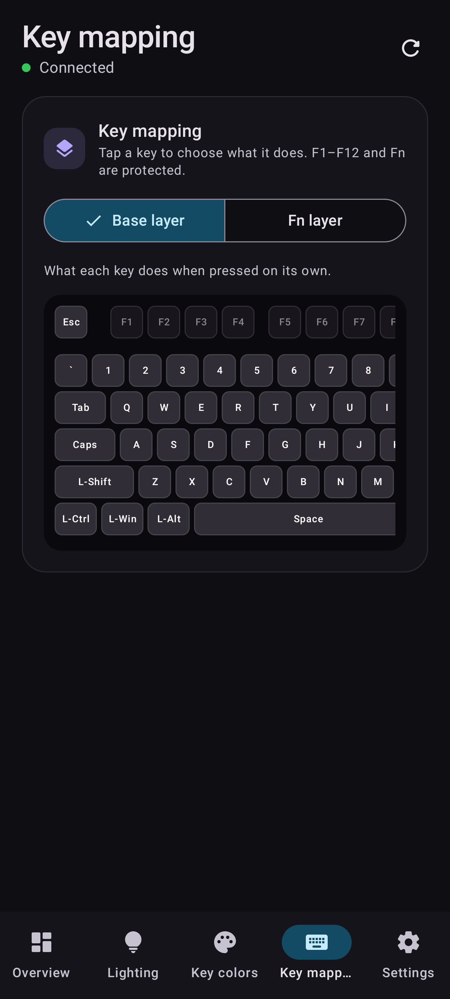
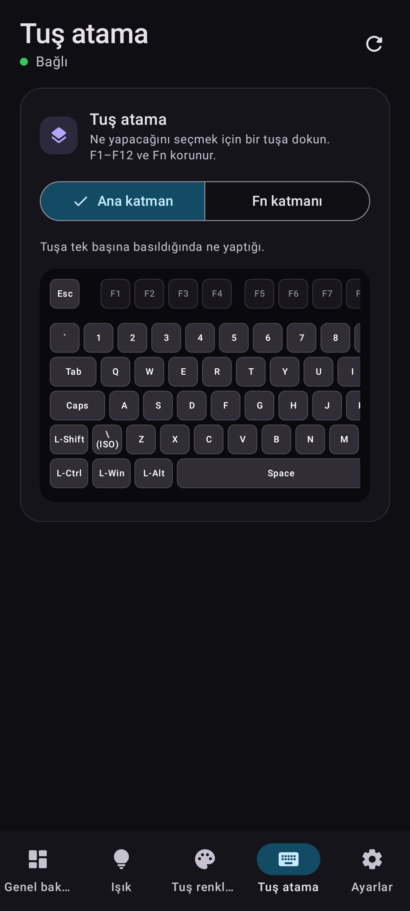
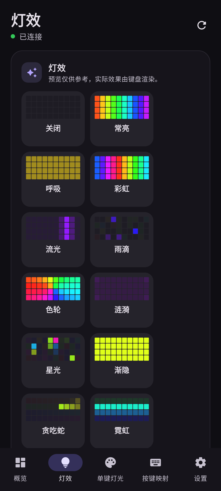
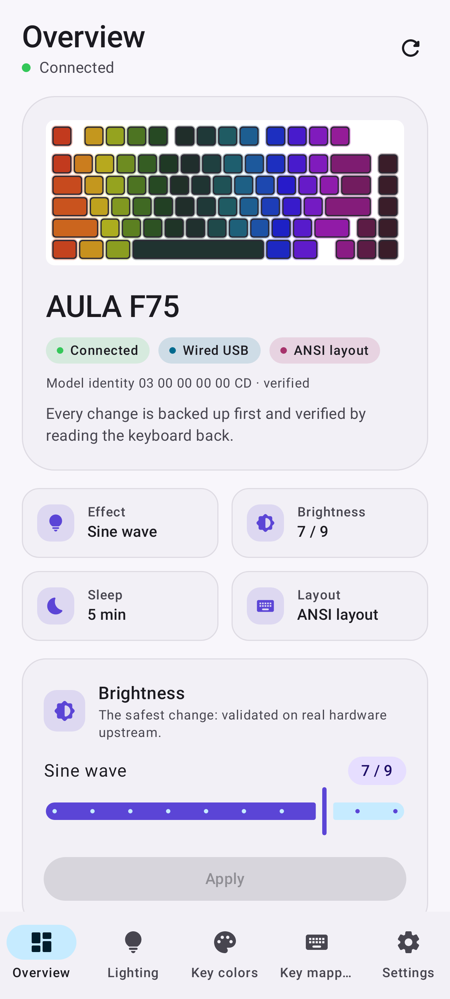
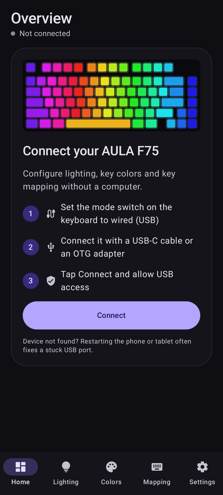
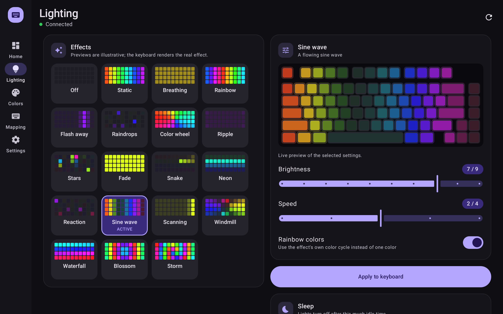

<div align="center">

# AULA Studio for Android

**Configure the AULA F75 from an Android phone or tablet. No computer needed.**

Unofficial Android port of [AULA Studio](https://github.com/Dahuum/aula-studio) · Kotlin · Jetpack Compose · USB OTG · MIT

English · [Türkçe](README.tr.md) · 简体中文 UI



</div>

---

## Why

AULA's official configurator only runs on Windows. [Dahuum/aula-studio](https://github.com/Dahuum/aula-studio) reverse-engineered the F75's wired protocol and brought it to Linux, Windows and macOS. Many people own the keyboard but use it with a phone or tablet only. This project brings that work to **Android**, with the same safety rules.

## Features

| | Status |
|---|---|
| Connect over USB-C / OTG, verify the six-byte model identity | ✅ |
| Read every bank: configuration, effect palette, base and Fn keymaps, per-key RGB | ✅ |
| Brightness of the active effect, the write upstream validated on hardware | ✅ always on |
| 18 hardware effects: brightness, speed, rainbow mode, color (color wheel) | 🧪 experimental |
| Sleep timeout | 🧪 experimental |
| Per-key RGB editor | 🧪 experimental |
| Key mapping, base and Fn layers: keys, 14 media actions, 5 mouse buttons | 🧪 experimental |
| ANSI and ISO (Turkish-Q / European) layouts, detected from the Fn record | ✅ (ISO 🧪) |
| Automatic backups and verified restore | ✅ |
| English, Türkçe, 简体中文; light and dark theme; phone and tablet layouts | ✅ |
| Macros, wireless (2.4 GHz / Bluetooth) configuration, firmware | ❌ by design (not in upstream either) |

🧪 *Experimental* features are hidden behind a switch. Their encoders are a faithful port of upstream, where they are reverse-engineered and offline-tested, but not yet validated on a physical keyboard.

## Screenshots

| Overview | Lighting | Key colors | Key mapping |
|---|---|---|---|
|  |  |  |  |

| Türkçe (ISO Turkish-Q) | 简体中文 | Light theme | Connect |
|---|---|---|---|
|  |  |  |  |



*Screenshots are rendered automatically by CI from the real UI with simulated keyboard data (Robolectric + Roborazzi).*

## Install

1. Open the [latest release](../../releases) on your phone and download `AULA-Studio-Android-*.apk`.
2. Open it and allow installing from your browser or file manager if Android asks.
3. Set the keyboard's mode switch to **wired**, connect it with a USB-C cable or OTG adapter, and tap **Connect**.

Every CI build uses the same signing key, so new versions install over old ones and keep your backups.

> **Tablet doesn't see the keyboard?** If the keyboard charges but doesn't type over the cable, check the wired mode. If no USB device shows up in *Settings → USB diagnostics*, restart the phone or tablet. A stuck USB host port is a common cause.

## Safety model

The rules below follow the transaction contract of aula-studio ([docs/PROTOCOL.md](https://github.com/Dahuum/aula-studio/blob/main/docs/PROTOCOL.md), [HARDWARE_SAFETY.md](https://github.com/Dahuum/aula-studio/blob/main/docs/HARDWARE_SAFETY.md)):

- **No firmware, bootloader, reset or erase command exists in the code.** Only the documented banks are written: config `0x04`, palette `0x0a`, keymap `0x03` and per-key `0x06`.
- The app configures only the device whose identity reply is `03 00 00 00 00 CD`, the original F75. A matching USB ID alone is not enough.
- **Read, compare, back up, write, read back.** Before every write the keyboard is read again. If it differs from what the user reviewed, nothing is written. A backup is saved, only the changed banks are written in the official order, and success is reported only after an exact byte-for-byte readback. There are no automatic retries or blind rollbacks.
- Only the bytes the user changed are modified. Unknown fields are preserved.
- **F1–F12 and both Fn slots (53/59) can never be remapped, and no key can be disabled**, so Fn combinations and the factory reset always stay reachable.
- Key mapping and per-key RGB are enabled only when the Fn record is found at a known slot (53 = ANSI, 59 = ISO).
- The original state from the first connection is kept forever, and up to 40 automatic backups are kept after it.

## How it works

```
app/src/main/java/com/aulaf75/android/
├── protocol/           Pure Kotlin, no Android: a 1:1 port of crates/aula-protocol
│   ├── F75Protocol.kt  framing, config/palette/keymap/per-key codecs, error codes
│   ├── KeyboardLayout.kt ANSI + ISO geometry and matrix slots
│   └── KeyNames.kt     language-neutral key and record naming
├── KeyboardController.kt  the transaction contract above (pure Kotlin, testable)
├── usb/F75Usb.kt       Android transport: HID GET/SET_REPORT (Feature, ID 6, 520 B)
│                       as USB control transfers on interface 1; 20 ms / 70 ms timing
├── BackupStore.kt      hex JSON backups in app-private storage
├── MainViewModel.kt    state + one-at-a-time device operations
└── ui/                 stateless Jetpack Compose UI (AppScreen(state, actions))
```

On desktop, aula-studio talks to the keyboard through hidapi (`send_feature_report` / `get_feature_report`). Android has no hidraw access for apps, so `F75Usb` sends the same 520-byte reports as standard HID class requests: `SET_REPORT` (`0x21/0x09`, wValue `0x0306`) and `GET_REPORT` (`0xA1/0x01`). It claims only the configuration interface (1). The typing interface (0) is never touched.

## Build and test

```bash
./gradlew testDebugUnitTest      # protocol, transaction and screenshot tests
./gradlew assembleRelease        # signed APK in app/build/outputs/apk/release
python3 tools/strings.py         # regenerate translations after editing tools/strings.py
```

- **31 JVM tests** cover the protocol and transactions. They port upstream's fixtures and drive a simulated F75 to check exact bytes, write order, stale-state refusal, interrupted writes, protected keys, ISO detection and full restore.
- **19 screenshot tests** render every screen on phone and tablet in all three languages.
- CI ([workflow](../.github/workflows/aula-f75-android.yml)) runs everything, refreshes the screenshots and publishes a signed APK as a GitHub release.

### Adding a language

Add a column to `tools/strings.py`, add the folder in `write(...)`, add the locale to `res/xml/locales_config.xml` and to `LANGUAGES` in `SettingsScreen.kt`, then run the script.

## Status and how you can help

- ✅ Tested by a user on a real **ISO (Turkish-Q) F75** with an Android tablet (Xiaomi Pad 7 Pro): connection, the identity check (`03 00 00 00 00 CD`, the same as ANSI), reading every bank, and effect and color writes work.
- 🔎 In that test, three effects (Scanning, Storm, Fade) looked dark. Their stored palette color was most likely black. Version 0.2 starts from white and refuses near-black colors; confirmation is pending.
- ❓ Needs owners to report: the other effects, per-key RGB LED positions on ISO boards, key-mapping events on Android, and ANSI boards.
- 🤝 **For the aula-studio maintainers:** the `protocol/` package mirrors your crate module by module. If you'd like an official Android build, this project is offered to be merged as an `android/` directory or kept as a companion repository, whichever you prefer.
- 🤝 **For AULA:** an official Android or web configurator, or published protocol documentation, would help many owners who don't have a PC.

## Credits and license

- Protocol knowledge, offsets and safety rules: **[Dahuum/aula-studio](https://github.com/Dahuum/aula-studio)** (MIT). This app could not exist without that reverse-engineering work.
- AULA and F75 are trademarks of their owner. This is unofficial community software, not affiliated with or endorsed by AULA.
- License: [MIT](LICENSE).

`app/aula-f75-sideload.jks` is a deliberately public signing key for personal sideloading only. It is not suitable for store distribution.
